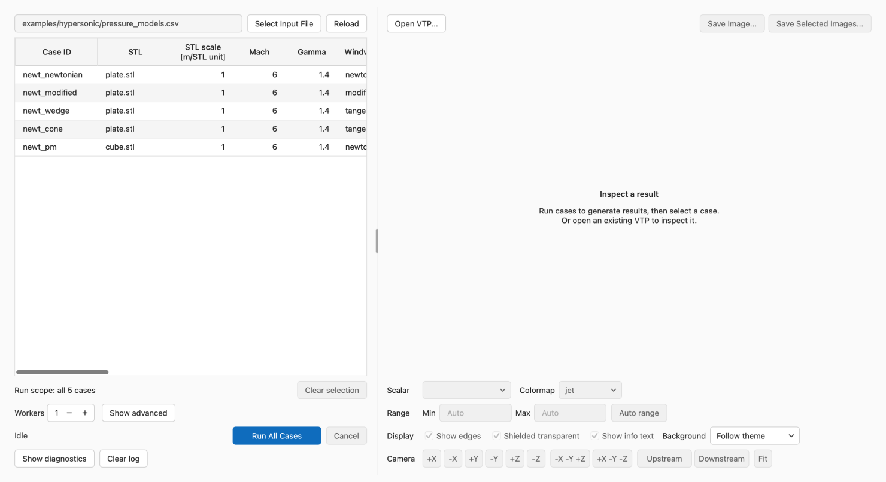
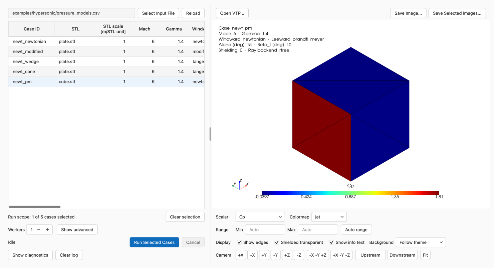

# GUI guide

Launch the GUI with a flow-domain selector:

```bash
panelsolver-gui fmf
panelsolver-gui hypersonic
```

These open `Panel Solver — FMF` and `Panel Solver — Hypersonic`.



*A loaded Hypersonic case table, ready to run and inspect.*

## Run cases

1. Choose **Select Input File** or **File > Open Input File...** and open a CSV,
   XLSX, or XLSM case table. The platform's standard Open shortcut also works,
   and you can drop a case table onto the window. Before a table is loaded, the
   empty case area offers **Select Input File...** and **New from Example**.
2. Select one or more rows to run those cases. Use **Clear selection** to return
   to running all loaded cases; **Run scope** below the table shows the target,
   for example `Run scope: all 5 cases` or `Run scope: 2 of 5 cases selected`.
3. Leave **Workers** at its default for a first run. **Checkpoint** is an
   advanced setting shown by **Show advanced**. For larger batches, see
   [Batch execution and recovery](batch-execution-and-recovery.md).
   Both settings support direct entry, keyboard stepping, and minus/plus buttons.
4. Choose **Run All Cases** or **Run Selected Cases**, as shown for the selected
   rows, and select the Summary CSV destination. The suggested location is
   `<input_dir>/outputs/<input_stem>_result.csv`. **Run > Run Cases**
   (Ctrl+R; ⌘R on macOS) does the same, and **Run > Cancel Run** (Ctrl+.; ⌘. on
   macOS) cancels an active run.
5. Follow the progress state. Open **Diagnostics** for warnings and errors.

After editing the case table externally, choose **Reload** beside **Select Input
File** to reread the current CSV, XLSX, or XLSM without choosing it again. These
two buttons stay together and wrap below the input path when space is limited. Reload
resets the case selection; select rows again to run a subset. The button is
disabled until an input is loaded and during ordinary or sectional calculation
and saving. If reading fails, the previous cases are cleared and cannot be run;
fix the source and open it again. Reload does not reread sectional definition
CSVs; use **Reload** in the corresponding Sectional dialog for those files.

The run writes the selected Summary CSV and, when enabled, one VTP per case at
`<out_dir>/<case_id>.vtp`. Relative `out_dir` values use the input table's
directory. See [Case files](../inputs/case-files.md#paths-vtp-destinations-and-components)
for path rules.

If the final Summary CSV cannot be saved, the **Output Errors** message offers
**Retry**, and **Retry Save...** appears beside **Cancel** for later use. Either
saves the retained result to the same or another CSV destination without
recalculating cases or writing VTP files again. Fix the cause first, such as
freeing disk space or closing a program that holds the file open. The message
below the progress bar identifies the retained run's input filename and case
count. Reloading inputs or changing selections does not change that result.
Original and currently loaded case tables, STL files, planned VTP outputs, and
sectional definition files are protected against overwriting, including file
aliases and unselected cases.

The button disappears after a successful retry or a later completed calculation
replaces the retained result. Failed or cancelled calculations leave a previous
unsaved result available; they do not add their partial results to it. Results
are retained only for the current application session. Saving runs in the
background and temporarily disables ordinary and sectional calculations. If a
pending window close meets a Summary CSV save failure, the window remains open
for retry. Closing the window while a result is retained asks whether to save
it first: **Save** closes after a successful save, **Discard** closes without
it, and **Cancel** keeps the window open. Other output errors, such as a VTP
failure, remain in Diagnostics.

During cancellation, progress shows **Cancelling** until workers finish cleanup.
Closing the window during a run also requests cancellation and waits for cleanup.
[Batch execution and recovery](batch-execution-and-recovery.md#cancellation-and-calculation-failures)
explains cancellation boundaries and which outputs remain available.

## Sectional load batches

To start with a complete example, choose **File > New from Example > Sectional
Loads** and select a workspace directory. This copies the current domain's
Sphere-cone: Angle Effects table, the shared sphere-cone STL, and
`sectional_loads.csv`. The case table and the Sectional Loads dialog open with
those copied inputs, ready to run. Existing modified files are not overwritten.
Edit the copied definition CSV externally and use **Reload** to try changes.

For your own files:

1. Open a case table. Select case rows to run a subset, or leave the case selection
   empty to run all loaded cases, as with ordinary calculation.
2. Choose **File > Sectional Loads...** and open a separate
   [sectional definition CSV](../inputs/sectional-loads.md).
3. Select definitions in the read-only table to run a subset, or leave the
   selection empty to run all loaded definitions. Case and definition selections
   are independent; the run scope shows both effective counts and lists the
   target case IDs.
4. Choose **Run All Cases × Sections** or **Run Selected Cases × Sections**, then
   select the [sectional result CSV](../results/sectional-loads-csv.md) destination.
   The suggested path is `<input_dir>/outputs/<input_stem>_sectional_loads.csv`.
   Cancelling the file dialog does not start a calculation or change retained results.
5. Each target case is solved once and all selected definitions use that same
   in-memory execution. Results are saved automatically to the chosen path.
   The dialog shows completion/save status, pair counts and the saved path;
   inspect numerical results in the CSV. There is no result table or separate
   Export action. The Viewer VTP is not an input.

The definition table supports opening and reloading files, not definition
editing. Edit the CSV externally and reload it before starting a new batch.
A failed reload clears the runnable definitions and reports the error.
The open definition CSV is protected from ordinary Summary CSV output as well
as sectional output, including while the Sectional Loads window is hidden.
Opening or reloading definitions is disabled during ordinary calculation.

Starting a run freezes both selections and definitions. Later selection/file
changes do not relabel completed results. Run and export status are separate:
cancelled or failed batches save any successful pairs to the chosen destination,
with their actual terminal status. If no pair succeeds, the output is unchanged.
A save failure retains the calculation and offers **Retry** in the error
dialog. It opens the save chooser after the export worker has finished cleanup.
**Close** dismisses that message; **Retry Save...** remains available to select a
destination and save without rerunning physics. These actions also save retained
partial results with their original failed or cancelled batch status. The button is hidden after
successful saving and never substitutes current selections for the failed-save
snapshot.
Result rows include their actual case signatures, section IDs and terminal
batch status, including partial results.

Normal case solving and sectional solving cannot run simultaneously. Cancel
requests stop at safe boundaries; already-running parallel cases can finish.
Closing during a run requests cancellation and waits for calculation, automatic
export of successful pairs, and worker cleanup. Ordinary runs remain disabled
until both calculation and saving finish.
If saving fails while a close request is waiting, the window remains open so
you can use **Retry Save...**. Closing the Sectional dialog (including Esc) or
the main window while a failed-save result is retained offers **Save**,
**Discard**, and **Cancel**. Save closes only after a successful export; cancelling
the file chooser or another save failure keeps the window and results available.
Discard releases that dialog's unsaved result, and Cancel keeps it open.
Main-window close also checks hidden Sectional dialogs and checks Loads and Cp
independently when both hold unsaved results. Results are held only in the current
application session.
No intermediate Summary CSV or VTP is required or created by sectional runs.

For either domain, open `examples/<domain>/sphere_cone.csv` with
`examples/sectional_loads.csv`. `examples/README.md` in the checkout and
examples archive describes the definitions and what to compare.

## Organize the workspace

The case table shows all input fields, including extra fields, in their declared
order. Headers show units, and Case ID stays pinned while scrolling horizontally.
Hover over a geometry cell to read its full path. When the input path is longer
than its field, leading folders are shortened so the file name stays visible;
hover over the field for the full path, or use **Copy Path** from its context
menu. Drag the grip between the case table and the Viewer to resize them.

Window placement, split position, column widths, Diagnostics visibility, and
the **Show advanced** state are remembered separately for each domain. Saved
widths expand as needed to fit headers. **View > Reset Layout** restores the
initial workspace layout.
Input files, row selection, execution settings, and color-range values are not
restored by this layout feature.

Viewer file actions (**Open VTP...**, **Save Image...**, **Save Selected
Images...**) sit above the display; scalar, range, display, and camera controls
remain available below it. Related controls wrap together in a narrow window,
as do each run setting and its label; run and cancel actions stay together.

## Start from an example

Choose **File > New from Example** and an example for the active domain. Select
a workspace directory; the GUI copies the case table and required geometry there,
keeping their relative layout, then opens the copied table. Edit and rerun this
workspace copy. The [Quickstart](../getting-started/quickstart.md) explains the
Basic example and its first results.

## View and export

### Select a result

When a case saves VTP, the first selected case's result loads automatically.
Selecting a row also loads an existing `<out_dir>/<case_id>.vtp` when its
`case_id` and `case_signature` match the selected case. For missing or mismatched
files, the center of the Viewer explains why a matching result is unavailable.



*The `newt_pm` case with its matching VTP colored by `Cp`.*

Use **File > Open VTP...**, the Viewer **Open VTP...** button, or drop a `.vtp`
file onto the window to inspect a file manually, independently of the selected
row. A file does not need to match a loaded case to be inspected.

**Show info text** displays the case identity and conditions over the geometry.
There is no separate status row above the display. An empty Viewer displays
guidance for selecting a result or explains why a result is unavailable. Read
and write errors include a **Diagnostics** button below the central explanation.

### Choose surface data and coloring

Select a cell scalar, colormap, and camera direction below the Viewer. The
colorbar shows the scalar name above the bar and the tick values below it. The
scalar labels correspond to these [VTP fields](../results/vtp.md):

| VTP field | GUI label |
|---|---|
| `cp` | Cp |
| `normal_traction_coeff` | Normal traction coeff. |
| `tangential_traction_coeff` | Tangential traction coeff. |
| `shielded` | Shielded |
| `theta_deg` | Theta [deg] |
| `area_m2` | Area [m^2] |
| `center_x_stl_m` | Center X [m] |
| `center_y_stl_m` | Center Y [m] |
| `center_z_stl_m` | Center Z [m] |
| `stl_index` | STL index |

Set **Min** and **Max** to choose color limits; leave either endpoint blank for
an automatic limit. The colorbar shows the actual range. Invalid numeric text
falls back to automatic, with the input marked and a tooltip explaining why.

**Camera** views the model from an STL axis direction, from one of two
isometric directions, or from **Upstream** or **Downstream** along the case
flow direction. **Fit** refits the model in the view without rotating it.

**Background** offers **Follow theme** (initial), **White**, and **Black**.
Following the theme uses white in light mode and black in dark mode. An explicit
color stays selected across theme changes for the current window. Text and axes
use a contrasting color, and saved images include the selected background.

### Smooth color distributions

Enable **Smooth colors** in the Display row to interpolate continuous panel
values across the surface. The default is off, preserving the original
constant value on each panel. Turn off **Show edges** for an uninterrupted
color distribution; edge visibility remains an independent choice.

Smooth colors uses the arithmetic mean of adjacent panel values at each vertex,
then interpolates those values across each face. The display copy joins exactly
coincident vertices within each STL component and shielding group. It does not
average across those groups or along sharp edges exceeding 30 degrees. Where a
sharp edge ends inside a surface, the vertex at its tip is not split, so values
there can still blend across that edge. The exact threshold is subject to
floating-point precision. The original mesh and result arrays, calculations,
Summary/sectional CSVs and VTP files remain unchanged. Automatic color limits
still use the original panel values, so switching display modes preserves the
color scale.

The colorbar title includes **(interpolated)** while active, including in saved
images. This is a visualization aid: peaks may be reduced and jumps within a
smooth surface may blur. Switch it off to inspect original panel values.
**Shielded**, **STL index**, and boolean fields always use panel values; the
control is disabled for these fields and resumes its previous choice when a
continuous scalar is selected. The choice applies to subsequent loaded results
and image exports in the current window.

If interpolation fails, the Viewer keeps the requested setting, uses panel
values for that display only, labels the colorbar with the failure, and logs
the reason in Diagnostics once. A failure is not retried for the same loaded
result; reload the VTP to retry. Subsequent valid results resume interpolation.
If any panel would be lost from the smoothed display, the whole view falls back
to panel values rather than showing a partial surface. Malformed `stl_index` or
`shielded` arrays do not prevent ordinary VTP inspection; only Smooth colors
falls back. Both modes treat every nonzero `shielded` value as shielded, and
imported shading normals are kept.

With Smooth colors off, imported VTPs keep PyVista's existing preference for
point data when a name exists in both associations.

The Viewer does not repair winding or reorient normals: the 30-degree split
uses normals from the original face winding. Oppositely oriented coplanar faces
therefore remain separate rather than being averaged, and non-manifold
junctions may also remain separated. Resolve mesh orientation problems before
calculation instead of relying on display interpolation to hide them.

### Save images

Use **Save Image...** to save the current view. For a VTP matched to a loaded
case, the suggested file is
`<out_dir>/images/<case_id>__<scalar_name>.png`, where `scalar_name` is the
VTP field name above, for example `normal_traction_coeff`. For an unmatched
manual VTP, the suggestion is under `images/` beside that VTP. Choose another
directory or name in the dialog as needed. Unsafe filename characters are
adjusted automatically.

**Save Selected Images...** exports images for the selected cases. It is
available when at least one selected case has a saved VTP. The suggested
directory is `images/` under their common output directory, or
`<input_dir>/outputs/images` if they use different output directories. Batch
export preserves existing images by adding a numeric suffix to duplicate names.
Manual export is also available for stale or unmatched VTPs, with the displayed
result preserved.

## Diagnostics and run status

**Show diagnostics** opens the log and changes to **Hide diagnostics**. Messages
continue to arrive while the log is collapsed. **Clear log** clears messages and
resets warning/error counts, including during an active run. Counts represent
messages received since the last clear or application launch.

| Status or issue | Meaning and action |
|---|---|
| Input validation issue | The message identifies the spreadsheet row, case ID, field, and problem. Edit the source table and reopen it before rerunning. |
| **Failed** | A case calculation failed, such as during geometry loading or model execution. Read Diagnostics for the cause. |
| **Completed with output errors** | Calculations finished, but output-directory preparation, VTP writing, or Summary CSV writing failed. Read the final error summary and Diagnostics. |

Read and write error states provide a direct route to Diagnostics. After a VTP
write failure, an older file at the planned path remains available through
**Open VTP...**, with automatic loading suppressed for that failed write.
See [Batch execution and recovery](batch-execution-and-recovery.md) for retained
results and rerun options.

## Offline help

The **Help** menu provides:

- **Documentation:** opens the bundled offline site in your desktop browser,
  including with a wheel installation.
- **About:** shows Panel Solver, its installed distribution version, the active
  domain, and the Apache-2.0 license. Include the version and domain in problem
  reports.

See [Troubleshooting](troubleshooting.md) for common problems.

## Sectional Cp batches

Choose **File > New from Example > Sectional Cp** for a complete sample.
After selecting a workspace folder, the application copies the case CSV, STL,
and Cp definitions, replaces the displayed case table with the sample cases,
and opens the Sectional Cp dialog with its definitions loaded. This follows the
same flow and logging as other examples, with no extra confirmation dialog.
Calculation starts only when you choose Run and an output CSV destination.

Choose **File > Sectional Cp...**, open a [Cp definition CSV](../inputs/sectional-cp.md),
select cases and definitions (empty selection means all), and run. Try
`examples/sectional_cp.csv` with either domain's `sphere_cone.csv` example.
The read-only workflow, frozen selections, cancellation, automatic CSV saving,
and **Retry Save...** follow Sectional Loads. The suggested output is
`<input_stem>_sectional_cp.csv`.

Each row saves both endpoints and the source panel's constant scalar. Hypersonic
extracts Cp; FMF extracts its normal traction coefficient. The dialog explains
this distinction; it does not plot or interpolate the result. Ordinary solving,
Sectional Loads and Sectional Cp cannot run concurrently. Both definition files
remain protected against overwriting while their dialogs are hidden.
